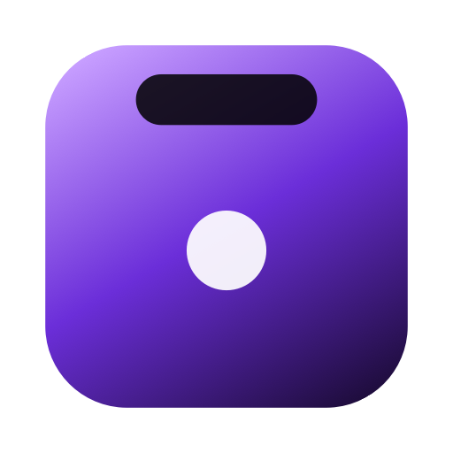
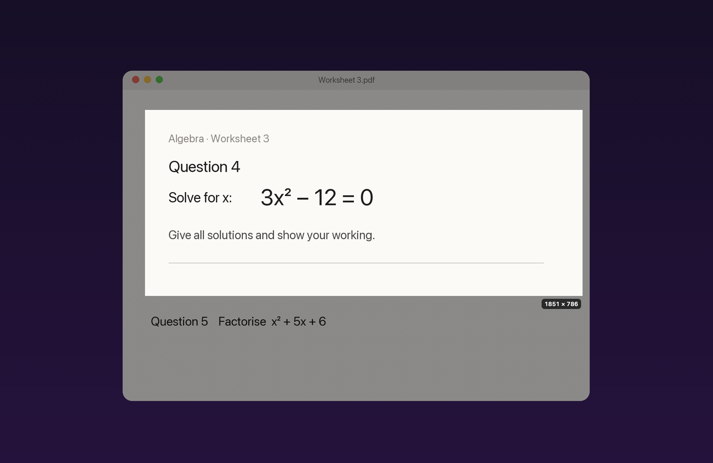
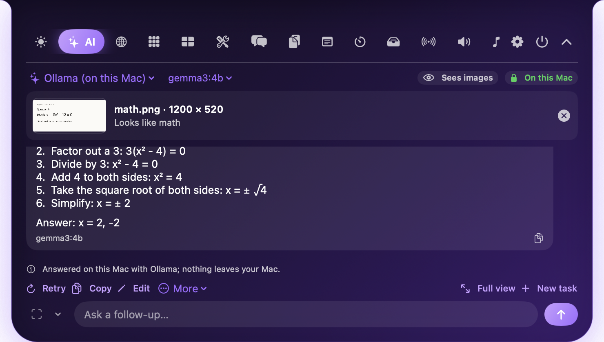
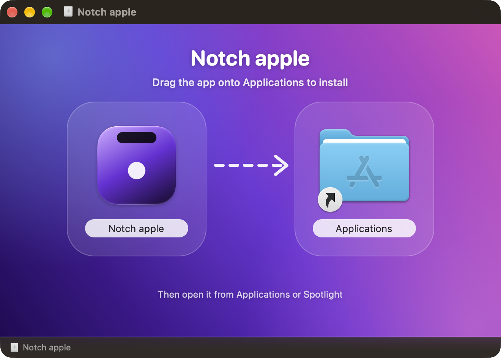

<p align="center">
  
</p>

<h1 align="center">Notch Apple</h1>

<p align="center"><b>AI, right where you need it.</b><br>
Press <kbd>⌃⌥S</kbd>, drag over anything on your Mac's screen, and solve, explain, translate or summarize it in a second, right from the notch.<br>
Free to start, source-available, with free AI or fully local AI on your Mac. Plus 30 more tools in the notch.</p>

<p align="center">
  <a href="https://github.com/AdityaJainDXB/NotchApples/releases/latest"></a>
  
  
  <a href="LICENSE"></a>
 
</p>

<p align="center">
  <a href="https://github.com/AdityaJainDXB/NotchApples/releases/latest"></a>
  <a href="https://github.com/AdityaJainDXB/NotchApples/actions/workflows/windows-build.yml"></a>
  <a href="https://adityajaindxb.github.io/NotchApples/"></a>
</p>

<p align="center">
  <a href="#download"><b>⬇️ Download</b></a>
  &nbsp;·&nbsp; <a href="https://adityajaindxb.github.io/NotchApples/"><b>🌐 Website</b></a>
  &nbsp;·&nbsp; <a href="#whats-new"><b>✨ What's new</b></a>
  &nbsp;·&nbsp; <a href="#pro-and-ultimate"><b>🔑 Pro and Ultimate</b></a>
  &nbsp;·&nbsp; <a href="#donate-"><b>💜 Donate</b></a>
</p>

<p align="center">
  
  
</p>

**Contents:** [What is Notch Apple?](#what-is-notch-apple) · [Download](#download) · [Screenshots](#screenshots) · [What's new](#whats-new) · [Features](docs/FEATURES.md#features) · [Window management](docs/FEATURES.md#window-management) · [File Search](docs/FEATURES.md#file-search) · [Backup and sync your setup](docs/FEATURES.md#backup-and-sync-your-setup) · [Plugins](#plugins) · [iPhone companion](docs/FEATURES.md#iphone-companion) · [Focus](docs/FEATURES.md#focus) · [AppleScript](docs/FEATURES.md#applescript) · [Performance](docs/FEATURES.md#performance) · [Live activities API](#live-activities-api) · [Control the notch from Shortcuts](docs/FEATURES.md#control-the-notch-from-shortcuts) · [Updates](docs/FEATURES.md#updates) · [Notch Apple for Windows](docs/FEATURES.md#notch-apple-for-windows) · [Want a lighter version?](#want-a-lighter-version) · [Permissions](docs/REFERENCE.md#permissions) · [AI in the notch](docs/FEATURES.md#ai-in-the-notch) · [Keyboard shortcuts](docs/REFERENCE.md#keyboard-shortcuts) · [Pro and Ultimate](#pro-and-ultimate) · [Troubleshooting](docs/REFERENCE.md#troubleshooting) · [Face unlock](docs/GUIDES.md#face-unlock) · [Using Messenger](docs/GUIDES.md#using-messenger) · [Build from source](docs/BUILDING.md#build-from-source) · [Why some features need a paid Apple Developer account](docs/BUILDING.md#why-some-features-need-a-paid-apple-developer-account) · [Privacy](#privacy) · [Thanks to the collaborators 🙏](#thanks-to-the-collaborators-) · [Donate 💜](#donate-) · [License](#license)

**Contents:** [What is Notch Apple?](#what-is-notch-apple) · [Download](#download) · [Screenshots](#screenshots) · [What's new](#whats-new) · [Plugins](#plugins) · [Live activities API](#live-activities-api) · [Want a lighter version?](#want-a-lighter-version) · [Documentation](#documentation) · [Pro and Ultimate](#pro-and-ultimate) · [Privacy](#privacy) · [Thanks to the collaborators 🙏](#thanks-to-the-collaborators-) · [Donate 💜](#donate-) · [License](#license)

## What is Notch Apple?

Notch Apple lives in the black cutout at the top of your MacBook screen (a small pill on Macs without one). Press <kbd>⌃⌥S</kbd> in any app, drag a box around a maths problem, an error, a paragraph in another language or a chart, and pick what to do: **Solve, Explain, Translate, Summarize, Code**… The answer streams into the notch, and you can keep asking follow-ups about the same capture. It also brings F1 live timing, live tennis from every ATP and WTA tournament, window snapping, clipboard history, Now Playing and many more tools. Everything is optional, and only the Pro extras need a key.

| | |
| --- | --- |
| 📸 **Instant capture** | <kbd>⌃⌥S</kbd> from anywhere, even full screen: a region, a single window, the whole display, or all displays. Retina-sharp, on the display under your pointer |
| 🧠 **AI vision & modes** | Solve (maths), Explain, Explain simply, Answer only, Hint, Summarize, Translate, Extract text (on your Mac), Rewrite, Code, Ask |
| 💬 **Follow-ups** | Ask "why?" or "explain step 3": the AI still sees your capture. Stop, Retry, Edit, Copy, export |
| 📋 **Any input** | Paste an image or text (<kbd>⌘⇧V</kbd>), drop an image or PDF, or use the text you selected |
| 🕘 **History** | Local, searchable, with the image, mode and model; reopen and continue |
| 🔒 **Free or fully local AI** | Gemini, Groq or OpenRouter for free, Ollama on your Mac (offline, no key), or your own Claude, ChatGPT or DeepSeek key |
| ⚽ **Sports & cricket** | Your team with match alerts, fixtures, league tables and match details (goals, cards, lineups); national teams, India cricket and the IPL |
| 🏁 **F1** | Live running order, classification with gaps and tyres, schedule countdown, standings, a favourite driver or team beside the notch |
| 🎾 **Tennis** *(new)* | Every ATP and WTA match with live set scores in **Men, Women and Mixed** tabs, **Grand Slams in red**, earlier weeks and past Slams one click back, the **ATP and WTA top 20**, and your favourite players' live score beside the notch |
| 🪄 **Do It** *(Ultimate)* | Tell the AI what to do (a worksheet, a form, a task) and it does it on your screen, step by step, with a Start button, a Stop button that works from any app, and questions before anything risky |
| 🔁 **Convert** *(Ultimate)* | Drop any file and turn it into another kind: PPTX → PDF, HEIC → JPG, DOCX → PDF, MOV → MP4, PNG → ICO, XLSX → CSV, PDF → pictures, pictures → one PDF, zip and unzip. Saved next to the original |
| ⌨️ **Klick** *(Pro)* | Mechanical keyboard sounds as you type, in any app: Mechanical, Cream, Holy Panda, Blue, Red, Brown, Topre, Typewriter or Bubble, plus four premium sounds downloaded with your key (Cherry MX Black, Gateron Ink, Alps, Buckling spring), each with its own volume, and an on / off switch |
| 🖼 **Live wallpaper** *(Pro, new)* | Play a video as your desktop wallpaper: your own (up to 60 s, up to 4K) or a free NASA clip. Pauses on battery and when windows cover it; the lock screen shows a still |
| 📡 **Flight Radar** *(new)* | Every aircraft around you, live, on a round radar with callsign, type, height and speed (the free adsb.lol feed; your location is rounded to about 1 km and only sent while the tab is open) |
| ✈️ **Plane game** | A 3D flight sim in Games: Cessna to A380, fighters and helicopters, with real dials, engine sounds, flaps in notches, retractable gear, damage and spoken GPWS callouts. **Battle** adds co-op and multiplayer waves with clearer enemy markers, an aim ring, a battlefield warning, sturdy fighter wings, a G-force toggle and a self-destruct/respawn button that keeps the wave score. The simulator also has an **autopilot**, **ILS approaches**, **full-screen mode**, AI traffic, Clean start and optional Fly with others. |
| 🃏 **Poker** | Play-money Texas Hold’em against the computer in Games, with a persistent chip stack and a tested seven-card hand evaluator. |
| 🤖 **Notch Apple AI** *(included with Pro)* | Ask without setting up any key: the request goes to Notch Apple's server, which checks your key and answers with the project's own AI account (Pro 60 messages a day, Ultimate 200). Your own keys still work with no limit |
| 🗓 **Updates once a week** | Optional and off by default: be asked about updates once a week instead of for every release |
| 🧰 **30+ more tools** | Now Playing, window snapping, clipboard, file shelf, focus timer, Sports, Messenger, notes, search and more |

## Download

Pick your computer. Both buttons start the download straight away. The Mac link always opens the latest stable release; the Windows link always downloads the newest Windows installer.

<table align="center">
  <tr>
    <th align="center" width="50%">🍎&nbsp; Mac</th>
    <th align="center" width="50%">🪟&nbsp; Windows</th>
  </tr>
  <tr>
    <td align="center">
      <a href="https://github.com/AdityaJainDXB/NotchApples/releases/latest"><b>⬇️&nbsp; Download for Mac<br>(.dmg) · 2.2.7</b></a>
    </td>
    <td align="center">
      <a href="https://github.com/AdityaJainDXB/NotchApples/releases/download/windows-latest/NotchApple-Windows-Setup.exe"><b>⬇️&nbsp; Download for Windows<br>(.exe) · 2.2.4 BETA</b></a>
    </td>
  </tr>
  <tr>
    <td align="center">macOS 14 or newer<br>about 33 MB</td>
    <td align="center">Windows 10 or 11 (64-bit)<br>Beta: please report problems</td>
  </tr>
  <tr>
    <td align="center"><a href="#install-on-mac">Mac install steps</a></td>
    <td align="center"><a href="#install-on-windows">Windows install steps</a></td>
  </tr>
</table>

### Install on Windows

**It takes about a minute. You do not need an administrator password.**

1. **Click "Download for Windows" above.** A file called `NotchApple-Windows-Setup.exe` saves to your **Downloads** folder.
   Chrome or Edge may say the file *isn't commonly downloaded*. That's only because it's a new, uncommon download: click **Keep** (in Edge, open the **…** menu next to the file first).
2. **Double-click the file** and click through the installer.
   If a blue **"Windows protected your PC"** window appears, click **More info**, then **Run anyway**. Windows shows this for every app that doesn't pay for a code-signing certificate. The full source code is in this repository.
3. **Open Notch Apple.** If it doesn't open by itself, press the **Windows key**, type `Notch Apple` and press **Enter**.
   A slim pill appears at the **top centre of your screen**. Click it to open the panel, or press **`Ctrl + Alt + N`** from any app.
4. **Free to start.** Everything free works straight away. If you bought Pro or Ultimate, open **Settings → Access** and enter your key (`NTCH-…`, the same key as the Mac app, valid on up to 3 devices).

<details>
<summary><b>Something not working on Windows?</b></summary>

- **I can't see it.** Look at the very top centre of your screen. Or find the Notch Apple icon near the clock (click the **^** arrow if it's hidden), right-click it and choose **Open notch**. If you pressed `Ctrl + Alt + O`, the notch is hidden: press it again.
- **It doesn't start with Windows.** Not yet. Open it from the Start menu when you want it.
- **My antivirus removed the file.** Restore it from the antivirus quarantine, or [build it yourself](docs/BUILDING.md#build-from-source).
- **Updating.** Download again and run the new installer. It replaces the old version.
- **Remove your key from this PC.** **Settings → Access → Remove the key from this PC** frees the device slot.
- **Uninstall.** **Settings → Apps → Installed apps → Notch Apple → Uninstall.**
- **Need an `.msi` instead** (for a work-managed PC)? Get [`NotchApple-Windows.msi`](https://github.com/AdityaJainDXB/NotchApples/releases/download/windows-latest/NotchApple-Windows.msi).
- **Other Windows versions:** the [releases list](https://github.com/AdityaJainDXB/NotchApples/releases) keeps the recent Windows builds (1.31.0 and newer). Older downloads were removed to keep the list short; the app updates itself to the newest one.

</details>

### Install on Mac

#### With Homebrew

One command:

```bash
brew tap adityajaindxb/notchapples https://github.com/AdityaJainDXB/NotchApples
brew install --cask notch-apple
```

Update later with `brew upgrade --cask notch-apple`. The first time you open it, macOS may block it because it isn't notarized: go to **System Settings → Privacy & Security** and click **Open Anyway**.

#### Manually

<p align="center"></p>

1. **Click "Download for Mac" above.** On the page that opens, click the **`NotchApple-x.y.z.dmg`** file under **Assets** to download it.
2. Open it and drag **Notch Apple** into **Applications**.
3. The app is ad-hoc signed, not notarized, so on first launch right-click the app and choose **Open**, then confirm. (Or run `xattr -dr com.apple.quarantine "/Applications/Notch Apple.app"`.)
4. Click the notch, or the menu-bar icon, to get started.

On a Mac without a notch, a slim pill appears at the top center of the menu bar instead.

---

## Screenshots

More screenshots of the capture overlay, the AI answer, the settings and the Windows app are in [docs/SCREENSHOTS.md](docs/SCREENSHOTS.md).

## What's new

### Mac 2.2.65 · Windows 2.2.65 · 12 November 2026 · 👥 Add friends to a group

- Fixed: in a Messenger group chat anyone in the group can now add their own friends, not just whoever made it. Open the group's ⋯ menu (or right-click it) and choose Add friends. Only the person who made the group can rename it or remove people. Everyone in the group needs this update for the new people to show up for them

### Mac 2.2.64 · Windows 2.2.64 · 12 November 2026 · Typing, the time pill and volume

- Fixed: text you type in the notch is easier to see. Fields such as a group name, your friend code and several search boxes showed dark text on the dark notch; they now use your theme's text colour
- Fixed: the date and time pill under the notch now keeps the time up to date, goes away when you move off the notch or open it, and no longer pops up while the notch is closing
- Fixed: changing the volume with the keys, by scrolling on the notch, or with the slider in Audio no longer freezes or stutters. The changes are now merged and written in the background

### Mac 2.2.63 · Windows 2.2.63 · 12 November 2026 · More for NotchAI, and a Report tab

- New: NotchAI chat keeps a history, has Stop and Regenerate, checks your Ollama setup, can start at login and respects Reduce Motion. NotchAI stays local first: cloud and unverified models are refused unless you turn them on
- New (Pro): NotchAI can search the web with no key (DuckDuckGo, your own SearXNG server, or Wikipedia, your choice in Research), read the top pages and answer with citations. Each question says which service it goes to, and nothing is searched until you ask
- New (Pro): NotchAI reads Word, Excel and PowerPoint files as well as PDF, text and images, only reading them and never changing them. Drop files on the NotchAI tab or its window to list them in Documents and summarise them
- New: Settings has a Report tab. It opens a GitHub issue that already says Mac, your version and your plan; you read it and press Submit yourself
- Fixed: only Messenger is locked when you take the lock offer. Games and Search had been locked too by an old default; they are unlocked now unless you chose to lock them yourself
- Fixed: typing in the Settings search box now shows your text

## Plugins

Put a script in `~/Library/Application Support/Notch apple/Plugins` (or click **Add example** in the Plugins tab), and its output shows as a card in the notch. Any language works: shell, Python, Ruby, anything with a `#!` line.

- The **first line** of output is the card's headline; the **other lines** are its text.
- Add `| href=https://…` to a line to make it a link, or `| run=command` to run a shell command when it's clicked.
- The **file name sets how often it runs**: `weather.10m.sh`, `cpu.5s.py`, `news.1h.rb` (default every 5 minutes). Scripts are stopped after 10 seconds.

```bash
#!/bin/zsh
echo "Disk: $(df -h / | awk 'NR==2 {print $4}') free"
echo "Uptime $(uptime | sed 's/.*up \([^,]*\),.*/\1/')"
echo "Open GitHub | href=https://github.com"
```


The full format, the SDK (Ultimate) and how to add a plugin to the gallery: [docs/PLUGINS.md](docs/PLUGINS.md).

## Live activities API

*Ultimate.* Show your own live activity beside the closed notch, from Terminal, Shortcuts or your own app. Activities only exist on your Mac, in memory.

Details and examples: [docs/REFERENCE.md](docs/REFERENCE.md#live-activities-api).

## Want a lighter version?

Every feature is optional, so the easiest way to slim Notch Apple down is to **turn off what you don't need in Settings → Modules**. Turned-off modules disappear from the notch and stop running in the background.

Older versions (1.15.3 and earlier) are no longer available to download: they were made before Free, Pro and Ultimate. Every current version includes everything they had. All releases since 1.16.0 are on the [releases page](https://github.com/AdityaJainDXB/NotchApples/releases).

## Documentation

| | |
| --- | --- |
| [Features](docs/FEATURES.md) | Window management, file search, backup and sync, the iPhone companion, Focus, AppleScript and Shortcuts, performance, updates, Windows, AI in the notch |
| [Guides](docs/GUIDES.md) | Face unlock, Messenger |
| [Reference](docs/REFERENCE.md) | Permissions, keyboard shortcuts, troubleshooting, the live activities API, privacy |
| [Building from source](docs/BUILDING.md) | Build the Mac, iPhone and Windows apps; why some features need a paid developer account |
| [Plugins](docs/PLUGINS.md) | Write and share plugins |
| [Changelog](CHANGELOG.md) | Every release |
| [Contributing](CONTRIBUTING.md) · [Support](SUPPORT.md) | Help improve it, or get help |

## Pro and Ultimate

Notch Apple is free, and the free tier is complete. Two one-time upgrades add more:

| | Free | Pro · $5 once | Ultimate · $15 once |
|---|---|---|---|
| The notch, Now Playing, timers, calendar, weather, clipboard, shelf, F1, sports, games, window snapping, backup | ✓ | ✓ | ✓ |
| AI: ask anything with your own free key or Ollama | ✓ | ✓ | ✓ |
| AI about your screen (⌃⌥S), selected text, images and PDFs; AI History | | ✓ | ✓ |
| Messenger, Audio, Voice Notes, Screen Time, Quick Add, Launcher, Snippets, Mirror, Focus | | ✓ | ✓ |
| Meeting alerts, download progress, rain alerts, lyrics, sync across Macs | | ✓ | ✓ |
| Home, profiles, per-app rules, command palette, text expander, markup, web search, personas, voice, Markets, flight status, more themes | | ✓ | ✓ |
| Live Activities API, two activities at once, AI automations, plugin SDK and gallery, scripting, notes sync, beta channel, priority support | | | ✓ |

The full feature-by-feature plan is in [docs/TIERS.md](docs/TIERS.md).

- **Buy** on the [pricing page](https://adityajaindxb.github.io/NotchApples/pro.html), in Bitcoin, Ethereum, Solana or Litecoin. Each order gets its own exact amount, which is how the payment is matched to you. Your key is shown straight away and emailed.
- **Activate** in **Settings → License** (paste the key) or with the **Activate in Notch Apple** link. The key is checked on your Mac against a public key built into the app, so it works offline. It works on up to 3 of your Macs; **Deactivate this Mac** frees a slot.
- **Upgrade** from Pro to Ultimate for the $10 difference. Your Pro key keeps working until you activate the new one.
- **Lost your key?** Use **Lost my key?** on the pricing page; it's emailed to the address you bought with.
- **Keys from before tiers** (`NOTCH-XXXX-XXXX-XXXX` and access codes) keep working as Pro.
- Refunds are case by case; see the [terms](https://adityajaindxb.github.io/NotchApples/terms.html).
- Questions about a purchase: **notchapples.support@gmail.com**.
- How the paid features are protected, and what a modified copy can and can't do: [docs/PROTECTING_PAID_FEATURES.md](docs/PROTECTING_PAID_FEATURES.md).
- The license server's source is published too: [server/license-worker](server/license-worker). Its signing key and admin codes are never in the repository.

## Privacy

Everything runs on your Mac. **Settings → Privacy** shows it live. The only network requests are the AI provider you chose (with your own key, and only when you ask; with Ollama or Apple Intelligence nothing leaves your Mac), update checks (which you can turn off), and the public data feeds for the features you open (weather, scores, F1, flights).

The full list of requests and what each one sends: [docs/REFERENCE.md](docs/REFERENCE.md#privacy).

 [docs/REFERENCE.md](docs/REFERENCE.md#privacy).

## Thanks to the collaborators 🙏

Notch Apple is built by a small group, and every one of them has shaped it:

- [**Aditya Jain**](https://github.com/AdityaJainDXB)
- [**Viraj Singh Chadha**](https://github.com/VirajSinghChadha)
- [**Saigamer007pro**](https://github.com/Saigamer007pro)

Thank you. 💜

## Donate 💜

Notch Apple is free and made by four high school developers. Donating is **completely optional**: it doesn't unlock anything, it just supports continued development. If it's useful to you, you can donate any amount in **Bitcoin, Ethereum, Solana or Litecoin**. Send on each coin's own network (not a token):

| Coin | Address |
|---|---|
| **Bitcoin (BTC)** | `bc1q6n68e5pkteuvs9fj38an340yj9vz5h84gu0gz5` |
| **Ethereum (ETH)** | `0x7CB03e86d62939C6BB743529Ba19E665a31dbCc5` |
| **Solana (SOL)** | `8Ri5sCbpdPRVz8rmrirJWH6hv7ZAKLcdb7AgJFfekpFC` |
| **Litecoin (LTC)** | `ltc1qymlmvkdmvpk5f90esthzgwaw6w0tuzq6tdr6kf` |

(The Ethereum address also receives USDC on Ethereum, and the Solana address USDC on Solana, if you prefer a stable coin.)

Every bit helps and is hugely appreciated. Want more too? [Pro is $5 and Ultimate $15](https://adityajaindxb.github.io/NotchApples/pro.html), each paid once. Donated already? Ask for a free Ultimate key.

## License

[Notch Apple Source-Available License](LICENSE). You can read, build and learn from the code and help improve it; selling or redistributing it, or unlocking the paid features without a key, is not allowed. Versions published before 9 October 2026 were MIT and stay that way for anyone who has them ([the MIT text](LICENSE-MIT-before-2026-10-09.txt)). Third-party parts keep their own licences (see `LICENSES/`).
