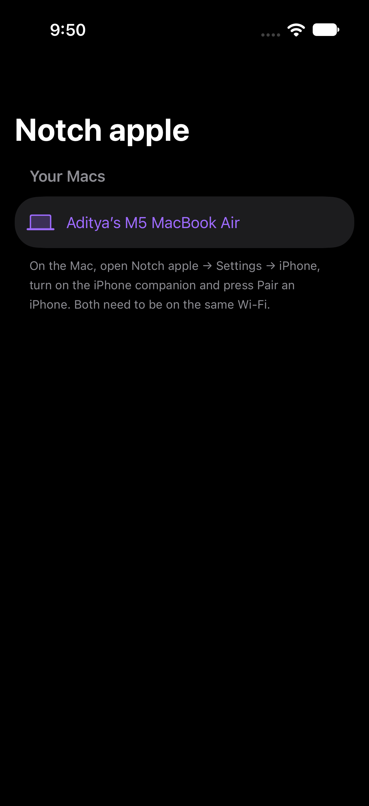

# Features

Everything Notch Apple can do, and how each part works. Back to the [README](../README.md).

## Features

Every module is **optional** and can be switched on or off in **Settings → Modules**. **Pro** features (AI, Messenger, Audio, VPN, Voice Notes, Screen Time & Focus Blocker, Quick Add) need an access code; everything else, including Now Playing, is free.

| Module | What it does |
| --- | --- |
| ☀️ **Today** | The date, current weather, your next calendar events (with a **Now** badge for meetings in progress) and battery at a glance. |
| ⏱ **Focus** | A Pomodoro timer: 25-minute focus sessions and 5-minute breaks, with a long break every 4th session. While it runs, **the countdown shows beside the closed notch**. You get a notification and a sound when each session ends. Lengths are adjustable in **Settings → Focus**. |
| 🔋 **Charging** | Plug in or unplug the charger and the notch briefly shows your battery level. Turn it off in **Settings → General**. |
| ✨ **AI** | Press <kbd>⌃⌥S</kbd> to **capture** part of any screen (or paste, drop an image or PDF, or use selected text) and pick a mode: Solve, Explain, Explain simply, Answer only, Hint, Summarize, Translate, Extract text (on your Mac), Rewrite, Code or Ask. Answers stream in with readable maths; Stop, Retry, Edit, Copy and follow-ups that remember the image. **Free** AI (Gemini, Groq, OpenRouter, or Ollama on your Mac) or your own Claude, ChatGPT or DeepSeek key. See [AI in the notch](#ai-in-the-notch). |
| 🪟 **Windows** | A split-screen window manager. **Drag any window up to the notch** and a strip of snap zones drops down: halves, quarters (4 windows on one screen), thirds, two-thirds, fill and center. Or snap from the Windows tab, or with `⌃⌥` + arrow keys. **Arrange all** tiles every window on the screen at once (split screen, 3 columns, a 4/6/9 grid, main + stack, cascade). Save a whole layout and put every window back in one click. See [Window management](#window-management). |
| 🧰 **Tools** | **Text Grab** copies the text from any area of the screen (even images and videos), recognised on your Mac. **Keep Awake** stops your Mac sleeping for 30 minutes, 1 or 2 hours, or until you turn it off. **Color Picker** picks any colour on screen and copies its hex code (right-click a swatch for RGB). **Calculator** answers as you type (`(12.5 + 7) × 3`), and Return copies the result. |
| 🪞 **Mirror** *(add-on)* | A live mirror from your Mac's camera to check how you look before a call. Flip, zoom, pick a camera, and a white **ring light** frame for dark rooms. The camera only runs while the tab is open, and nothing is recorded. Turn it on in **Settings → Modules**. |
| 🌍 **World Clock** *(add-on)* | The time in the cities you choose, with day or night and how far ahead or behind they are. Turn it on in **Settings → Modules**. |
| 📝 **Notes** | Quick notes in the notch: several notes, search, a "new note from clipboard" button, and saved automatically on your Mac. |
| 💬 **Messenger** | Chat anonymously with **people on the same Wi-Fi** (found automatically, encrypted between Macs), or **create or join an anonymous room** with a code, like `cafe-study` or `8821`. Rooms are end-to-end encrypted, and nothing is stored anywhere. You get a random handle like `PurplePanda#402`, and there are no accounts. See [Using Messenger](GUIDES.md#using-messenger). **New in 2.1.79: Friends**, a third mode for private one-to-one chat with people you add by a short friend code: nobody can message you until you accept them, messages are end-to-end encrypted (the server holds an encrypted copy only until your friend is online), and you can compare a safety number. Windows has it too (BETA, not yet tested on real Windows hardware), and Mac and Windows friends can chat. **Files and group chats in Friends** (Mac 2.2.4; Windows port built, not released and not yet tested on real Windows hardware): the paperclip sends a file up to 2 MB on Mac and Windows (160 KB before 2.2.8; encrypted like a message, sent a piece at a time and slowed down or retried if the relay's per-minute limit is reached, saved apart from the chat, shown in Finder or Explorer and never opened for you), and a group chat of up to 20 friends is sealed once per member over the existing friend links, with no group server, so Mac and Windows friends can share files and group messages. See [Using Messenger](GUIDES.md#using-messenger). **Two-player games** (Mac 2.2.7; Chess and Checkers in Mac 2.2.8): the *Games* menu in a room or friend chat invites someone to Connect Four, Rock Paper Scissors, Battleship, Chess or Checkers (picks and fleets are locked in with a hash and checked at the end, so cheating shows). **Windows has all five** (port built, not released and not yet tested on real Windows hardware or against a real Mac): the same *Games* menu in a room and in a Friends chat, with tic-tac-toe in Friends chats as well (Mac 2.2.5), and the notch grows to at least 800x600 while a board is showing. Chess has check, checkmate, stalemate, castling, en passant, choosing the piece for a pawn that reaches the last row, and the fifty-move, threefold-repetition and not-enough-pieces draws; Checkers has compulsory captures and multi-jumps. The second player sees the board turned round, the piece you pick shows where it can go, and the last move and a king in check are highlighted. Windows and Mac play each other with the same messages (`docs/FRIENDS_PROTOCOL.md`, "Two-player games"). Games are not saved: one ends if either app quits. **Files in rooms** (Mac 2.2.8; Windows port built, not yet tested on real hardware): the paperclip in a room sends a file up to 2 MB, cut into 8,000-byte pieces and put back together by the other side, which shows one file bubble (click it to show the file in Explorer or Finder; it is never opened for you). **On Windows, a room carries files only while it is connected to Notch Apple's own relay** (the Mac connects to it too); the free public relay (ntfy) is too small for files, so if the own relay is blocked on your network the paperclip says so and text and games keep working. Windows receives files from Mac rooms in all cases where the own relay is reachable, and keeps the newest 12 received files in memory while a room is open. **Tic-tac-toe**: press *Tic-tac-toe* in a room to invite everyone; the first to press Accept plays you on a 3x3 board, with rematch, on Mac and Windows (older versions just show the invite as a text line). |
| 📋 **Clipboard** | Everything you copy (text, links, images and files) is saved to a searchable history in the notch. Click an item to copy it again, pin the ones you want to keep, and filter by type. Items that password managers mark as secret are never saved, and history stays on your Mac. Choose how many items to keep in **Settings → Clipboard**. |
| 🔍 **Search** | Find files, apps and folders from the notch, powered by Spotlight, so results appear instantly with no indexing of its own. Use `↑`/`↓` to choose, `Return` to open, `⌘R` or `⌥`-click to show it in Finder, or drag a result onto the File Shelf or into any app. Choose the scope (your home folder or the whole Mac) and file types (apps, documents, images, PDFs, Downloads) in **Settings → File Search**. See [File Search](#file-search). |
| 🌐 **Translator** | Add-on: translate between Arabic, English, French, Spanish, Hindi, Mandarin and German, with a swap button, read-aloud and copy. Non-Latin results also show a pronunciation line you can read (pinyin for Mandarin, Latin letters for Arabic and Hindi), made on your Mac. The text you type is sent to the free MyMemory translation service (up to 500 characters at a time). |
| 📊 **Mac Stats** | Add-on: live RAM, CPU, network speed, battery and disk space. The **MacBook Center** widget (Small and Medium) shows the same in Notification Center; macOS limits how often widgets refresh, so use this tab for a live view. |
| 🌐 **Browser** | Add-on: browse the web and search from the notch. Type a website or a search in the address bar (it searches with DuckDuckGo, Google, Bing, Brave or Ecosia, your choice in **Settings → Browser**), with back, forward, reload, a start page with quick links, and a button to open the page in your default browser. It uses the same web engine as Safari and keeps your last page. |
| 🚀 **Launcher** | Add-on: a shelf of apps you choose. Add as many as you like from the list of installed apps, by dragging an app in, or with **Other…**; click a tile to open it from the notch, drag tiles to reorder, right-click to remove. |
| 🗂 **File Shelf** | Drag a file onto the notch and it opens straight to the shelf. Files stay there across relaunches thanks to security-scoped bookmarks. Double-click to open, or drag them back out. There's also an **Add files…** button. |
| 📡 **Share** | Send files with **AirDrop**, or use **PairDrop** between devices on the same Wi-Fi. To receive, just show your 6-digit code. To send, type the other device's code; there's no need to pick the device. No server is involved. |
| 🔊 **Audio** | Pick the output device, set the master volume, and change **per-app volume (0–150%)** and a **10-band per-app EQ** with presets. It's built in on macOS 14.2+, with nothing to install. |
| 🛡 **VPN** | A built-in list of **free OpenVPN servers** from [Zoult/.ovpn](https://github.com/Zoult/.ovpn) and [VPN Gate](https://www.vpngate.net), or import your own `.ovpn` / `.conf`. See [Using the VPN](GUIDES.md#using-the-vpn). |
| 🎵 **Now Playing** | Shows what's playing on your Mac: **Apple Music, Spotify, Anghami, browsers, podcasts**, anything in Control Center's Now Playing. Or pick one app to follow. Includes the **album cover**, a progress bar, previous / play / next and synced lyrics. While music plays, the closed notch shows the **album cover and moving bars**, like the iPhone's Dynamic Island; click it to open Now Playing. **New in 2.0.9:** a left / right **speaker balance** slider, and click the song for a **Spotify-style lyrics view** with the cover and a progress bar. |
| ⏲ **Timer** *(add-on, new)* | A countdown timer with one-click presets (1 min to 1 hr, or any length) and a stopwatch with laps. The time left shows **beside the closed notch**, and you get a sound and notification when it ends. |
| ✂️ **Snippets** *(add-on, new)* | Saved bits of text (addresses, sign-offs, replies, code). Click one and it's **pasted straight into the app you were using** (copied instead if Accessibility is off). |
| 🧱 **Shortcuts** *(add-on, new)* | Run any of your **Apple Shortcuts** from the notch, with a **Focus modes** row for shortcuts that switch Focus / Do Not Disturb. Shortcuts can drive the notch too, with [`notchapple://` links](#control-the-notch-from-shortcuts). |
| 🎧 **Devices** *(add-on, new)* | Battery for **AirPods** (left, right, case), **Magic Mouse, Keyboard and Trackpad**, with a low-battery alert at 15%. Shows **which apps are using your mic** and whether a **camera** is on, with a one-click **mic mute**. Shows your **iPhone's battery** when it's connected over Bluetooth, and **Ring my iPhone** opens Find My. |
| 🎾 **Tennis** *(new in 2.0.5)* | **Every ATP and WTA match of the week** (ESPN's free public feed): live, coming up and results, with set scores, tiebreaks and who's serving, in **Men**, **Women** and **Mixed** tabs (each with All, Singles and Doubles). **Grand Slams are painted red** with a 🏆 badge. ‹ and › step back and forward a week, and **🏆 Slams** jumps to any of the last four Grand Slams. The right side has the **ATP and WTA top 20** with points and movement, and your **favourite players**: star them in the rankings, click one in a match, or type a name. A favourite's matches come first, and their live score shows beside the closed notch. On for everyone. |
| 🏁 **F1** *(add-on, new)* | **Formula 1 live timing**: the live running order during every session (ESPN's free feed; live gaps need a paid F1 account), then the full classification with gaps, tyres, laps and the flag from F1's public timing archive. The weekend schedule in your time zone with a countdown, and driver and team standings (Jolpica). Click a driver to follow them, or pick a favourite team: their position (and the gap when F1 provides it) shows beside the notch while a session runs. |
| 🎮 **Games** *(add-on, new)* | Tiny games for a short break: **2048**, **Snake** and a **reaction test**, played with the keyboard in the notch. Best scores stay on your Mac. **New in 2.0.9: ✈️ Plane**, a 3D flight game with four planes, Hoop Rush, Time Trial, Landing and Free Flight, 14 challenges and a leaderboard. |
| 🧱 **Tetris** *(in Games)* | The classic falling blocks: 10×20 well, 7-bag pieces, rotation with wall kicks, **hold**, a **3-piece preview**, a **ghost piece**, soft and hard drop, line-clear scoring, levels every 10 lines and a saved best score. Pauses when you leave the tab. Mac and Windows. |
| 🔤 **Daily Word** *(in Games)* | A five-letter word puzzle: 6 guesses, green / yellow / grey hints, an on-screen keyboard that colours letters. **One puzzle a day**, the same word for everyone on the same date (no server, works offline), your **streak**, a share grid copied to the clipboard, and a **Practice** mode for extra words. Mac and Windows. **NYT puzzle** mode: the word of the day from The New York Times' public puzzle feed, fetched once a day by the app (the only thing Daily Word ever sends over the network; it sends no personal data, and the mode is hidden if the app cannot fetch). Any five-letter word is accepted in that mode. |
| ❓ **Daily Trivia** *(in Games)* | One multiple-choice question a day from a bundled set of 420 (science, history, geography, nature, sport, food, tech and general knowledge), the same for everyone on the same date. No network, works offline. See whether you were right, the correct answer and a one-line explanation; your **streak** and total correct are saved on your device, the result copies as emoji squares, and **Practice** gives five random questions with a score. Mac and Windows. |
| 🚀 **Rocket League** *(in Games, and in friend chats and rooms on Mac)* | Side-on car soccer: drive, jump, dash with a second jump and use boost to knock the ball into the other goal. Boost pads on the floor, three-minute matches with a golden goal, computer players (Easy, Normal, Hard; 1 v 1 or 2 v 2), or one against one online with a room code. In a friend chat or room (Mac 2.2.10) the Games menu invites someone and both land in the same match above the chat. On Windows it is in the Games tab (2.2.10), and the Games menu in friend chats and rooms has it too (built after 2.2.13, not yet released), playing against the Mac's. Shared code: `games/rocket.js` and `games/rocket-logic.js`. |
| ✏️ **Scribble** *(in Games, and in friend chats and rooms on Mac)* | Draw and guess, like scribble.io. Each turn one player is given three words, picks one and draws it; the others type guesses, and the faster you guess the more you score (the drawer scores too). Letters of the word are revealed as time runs out, a guess one letter off says "close", three rounds. Up to 10 players, **computer players included**: they draw simple pictures and guess honestly, from the length of the word and the letters shown (never from the drawing), at Easy, Normal or Hard. Play alone against computers, or online with a room code, or from a friend chat or an open room (the Games menu invites; anyone in the room can join). The word you must draw and your own guesses travel encrypted between you and the host (the room relay shows every message to everyone). Shared code: `games/scribble.js` and `games/scribble-logic.js`. Mac 2.2.13 in chats and rooms; on Windows the Games tab (2.2.13), and friend chats and rooms too (built after 2.2.13, not yet released). |
| 🏆 **Friends leaderboard** *(in Plane, Racing, Tetris and Daily Word)* | An optional top-20 table you share with friends through a 6-character **board code**. **Off by default**: nothing is sent until you switch on "Share my scores" *and* create or join a board. Then it sends only the game, your score, the display name you type and a random id made on your device. No accounts, no global list, no IP addresses stored; scores are honour-system. Works offline (the games keep working, the table just says it cannot load). Details, endpoints and limits: [LEADERBOARDS.md](LEADERBOARDS.md). Mac and Windows. *(Needs the score service deployed.)* |
| ⚽ **Sports** *(new)* | **Follow your team, Barcelona by default.** The next match with a countdown, all its competitions (league, Champions League, cups), recent results, and the live score beside the closed notch while it plays. Switch team in **Change** or by tapping a team. A league view shows the next two weeks of fixtures and scores for La Liga, the Premier League, Serie A, the Bundesliga, Ligue 1, the Champions League, the Europa League, Liga Portugal, the Eredivisie, MLS, NBA, NFL, MLB and NHL (ESPN's free public feed). On for everyone; turn it off in Settings → Modules. **New in 1.15.1:** match alerts (30 minutes before kick-off, a flash on goals and at full time), a **league table** (Fixtures / Table), **match details** (click a score: goalscorers, cards, lineups), **national teams** (World Cup, qualifiers, Nations League, Euro, Copa América, Asian Cup, friendlies) and **cricket** (India's internationals and the IPL). If ESPN is down, it says so instead of showing an empty tab. |
| 🏟 **Live** *(add-on, new)* | **Live scores** for the Premier League, Champions League, La Liga, MLS, NBA, NFL, MLB and NHL (ESPN's public scoreboard). Follow a team and its score shows beside the notch while it plays. Paste a **parcel or flight number** and it recognises UPS, FedEx, USPS, DHL or a flight and opens the right tracking page. |
| 🔔 **Notifications** *(add-on, new)* | Notifications from your other apps, in the notch, with a bell and count beside it when new ones arrive. **Reply to iMessages** without opening Messages. It reads Notification Center's own database (read-only, on your Mac), so it needs **Full Disk Access**. |
| 🧩 **Plugins** *(add-on, new)* | Make your own notch widgets in any language. See [Plugins](../README.md#plugins). |
| 🎙 **Voice Notes** *(Pro)* | Record a voice note from the notch. It's **transcribed on your Mac**, and one click turns it into an **AI summary with action items** (using your AI from Settings → AI). Play, copy or delete each one; the closed notch shows a timer while you record. |
| ⏳ **Screen Time** *(Pro)* | How long you spend in each app, today and over the week, with **daily limits** that nudge you when you go over. The **Focus Blocker** hides distracting apps you pick whenever a Focus session is running. It counts only while you're at your Mac, and everything stays on it. |
| 📅 **Quick Add** *(Pro)* | Type naturally, like "Dentist tomorrow 3pm", "Lunch with Sara friday 1pm for 90 min" or "remind me to pay rent on the 1st", and it goes straight into **Calendar or Reminders**, with a preview first. |
| 🔐 **Biometric Lock** | Requires Touch ID, Apple Watch, your password, or **face unlock** (your Mac's camera) before the notch opens. See [Face unlock](GUIDES.md#face-unlock). |
| 🧩 **Widget** | Small, medium and large desktop widgets with local weather, now playing, and your next calendar events. (macOS has no lock screen widget type yet; Apple's lock screen widget sizes are iPhone and iPad only.) |

**Live activities:** like the iPhone's Dynamic Island, the closed notch shows small indicators on either side:
- the focus countdown
- battery when charging, plus a **low battery warning at 20% and 10%**
- a purple dot for unread messages
- **timers and the stopwatch**
- the **screen recording timer**
- **download and copy progress** (Safari, Chrome, Finder, AirDrop)
- the **Keep Awake countdown**
- **"Join"** from 2 minutes before a Zoom, Meet, Teams or Webex call in your calendar (click the notch, then Join)
- **"rain in 15 min"**
- the **mic or camera** being in use
- a followed team's **live score**
- **new notifications**

Choose which ones show in **Settings → Notch Extras**.

**Gestures:** scroll with two fingers on the closed notch to change the volume, and swipe sideways to skip to the next or previous track.

**External displays:** the notch can live on your built-in display, on the display with the pointer (it follows you from screen to screen), or on the main display. Displays without a notch get a virtual one. Set this in **Settings → Notch Extras**.

**Also new in 1.14:**
- **Screen recording:**
  - pause and resume
  - a live timer beside the notch
  - the notch is left out of the video
  - a **trim** step when you stop
- **Synced lyrics** in Now Playing (from LRCLIB), plus previous, play/pause and next buttons.
- **Rain alerts** and **Join** buttons for video calls in Today.
- **Paste** straight from Clipboard history.
- **AirDrop everything on the File Shelf**.
- A **7-day focus chart**, and **Do Not Disturb during focus sessions** (via a shortcut; see Settings → Focus).
- A RAM graph and heat level in Mac Stats.


**Open the notch by clicking it, pressing `⌘J` (changeable in **Settings → Shortcuts & Hotkeys**) in any app, or dragging a file onto it.** Press `Esc` or `⌘E`, or click anywhere else, to close it.

**Open on hover (optional, off by default):** turn it on in **Settings → General**. The notch then opens when the pointer rests on it and closes when the pointer moves away. Click inside to keep it open while you type or drag. With the option off, hovering only highlights the notch.

`⌘J` is a system-wide shortcut registered through Carbon, so it needs no Accessibility permission. While it's on, other apps won't receive `⌘J` (it is Downloads in Safari and Chrome, and View Options in Finder). You can turn it off in **Settings → General**.

**Hide the notch with `⌃⌥O`** (change it in **Settings → Shortcuts & Hotkeys**): press it from anywhere to make the notch and its menu-bar icon disappear, and press it again to bring them back. Everything keeps running while it's hidden (music, timers, Messenger), and `⌘E` also brings it back. **Settings → Shortcuts & Hotkeys** shows whether it's visible or hidden and has the on/off switch.

When the VPN module is on, a **VPN On/Off** pill in the notch header shows the tunnel status. The full VPN setup (importing profiles and loading free servers) is under **Settings → VPN**.

## Window management

The **Windows** module arranges your app windows without leaving the notch. It needs one permission: **System Settings → Privacy & Security → Accessibility → Notch Apple** (the Windows tab has a button that takes you there).

- **Drag to the notch:** start dragging any window by its title bar and move the pointer up to the notch. Snap zones appear underneath; move onto one (its name lights up) and let go.
- **Snap from the notch:** open the Windows tab and click a layout. It applies to the window you were just using.
- **Arrange all windows:** *Split screen* (2 side by side), *3 columns*, *Grid* (4, 6 or 9 windows, depending on how many are open), *Main + stack* (one large window with the rest stacked beside it), or *Cascade*.
- **Saved layouts:** press **+** to remember where every window is, and click the saved layout later to put them all back. Apps that aren't open are skipped.
- **Next display** moves the window to your other screen, keeping its relative size and position.
- **Undo** puts the last snapped window back where it was.

| Shortcut | Action |
| --- | --- |
| `⌃⌥←` / `⌃⌥→` | Left / right half |
| `⌃⌥↑` / `⌃⌥↓` | Top / bottom half |
| `⌃⌥↩` | Fill the screen |
| `⌃⌥C` | Center |
| `⌃⌥⌫` | Undo the last snap |

The gap between windows, the drag-to-notch zones and the shortcuts can be changed in **Settings → Windows**. If you allowed Accessibility for a version before 1.12.0 and snapping doesn't work, remove Notch Apple from the Accessibility list with −, then turn it on again. From 1.12.0 the permission carries over to future updates.

Other things new in 1.11: the notch **remembers the last tab** you had open. Notch Apple is no longer sandboxed, because macOS only gives Accessibility to sandboxed apps from the App Store. Your settings, notes, clipboard and AI history are moved over automatically the first time 1.11 opens.

## File Search

The **Search** tab searches your Mac with Spotlight, the same index Finder and ⌘Space use, so it's instant and never walks folders on its own. Start typing and it shows the 30 best matches: exact names first, then names that start with what you typed, with apps ranked higher. Hidden files, caches, `node_modules`, build folders and system folders are skipped.

| Key | Action |
| --- | --- |
| `↑` / `↓` | Move the highlight |
| `Return` or click | Open |
| `⌘R` or `⌥`-click | Reveal in Finder |
| Drag | Drop onto the File Shelf, or into any app |

**Settings → File Search** turns the tab on or off, sets the scope (**User home folder only**, the default, or **Entire Mac**) and picks the file types to include. With every type ticked, folders and all other files are included too.

If macOS stops Notch Apple reading **Downloads**, **Documents** or **Desktop**, a warning appears with a **Grant Full Disk Access in System Settings** button that opens the right page.

Other things new in 1.12: **no more keychain password prompts.** Earlier versions saved API keys and face-unlock data in the login Keychain, and because the app is ad-hoc signed, macOS asked for your login password again after every update. They're now stored in a private file only your user account can read. After updating, paste your AI API keys again and set up face unlock again.

## Backup and sync your setup

**Settings → Backup & Sync** keeps your whole notch setup safe:
- **Notch Apple account:** **Continue with Google** (Sign in with Apple is coming) and your setup and access code are saved to your account, then restored on any Mac you sign in on, with Pro unlocked. It's stored in Firebase, where only you can read it; the access code is kept as a secure fingerprint, never the code itself. You'll find it in **Settings → Backup & Sync** and **Settings → License & Activation**.
- **Sync with your Apple ID:** turn on *Keep my notch setup in iCloud* and it's saved to iCloud Drive → Notch apple every time you change something. On a new Mac, install Notch apple, open this page and click **Restore from iCloud**. There's no separate account to create.
- **Backup file:** **Export settings…** saves a `.notchsettings` file, and **Import settings…** brings it back, on this Mac or another.

It covers your modules, tab order, theme, shortcuts, Notch Extras, snippets, launcher apps, cities and more. AI keys, your access code and your Messenger identity are never included.

## iPhone companion

*Ultimate.* An iPhone app that talks to your Mac over Wi-Fi, with no server in between.

From the iPhone you can:
- send text and links to the notch (text lands on the Mac's clipboard),
- see the Mac's battery and what's playing,
- play, pause or skip music,
- start a timer or Keep Awake,
- open the notch.

**Install** (it isn't on the App Store, which needs the paid developer program):
1. Download `NotchAppleCompanion.ipa` from the [latest release](https://github.com/AdityaJainDXB/NotchApples/releases/latest).
2. Install it with [Sideloadly](https://sideloadly.io) and your Apple ID. With a free Apple ID, iOS asks you to reinstall it every 7 days.
3. On the Mac: **Settings → iPhone**, turn on the iPhone companion, press **Pair an iPhone**, and type the 12-character code (letters and numbers) on the phone. Use the iPhone app from the same release as the Mac app: phones paired before keep working, but a new pairing needs the new app.

**How it works:**
- Both devices need to be on the same Wi-Fi.
- Pairing uses a code that works once, lasts 2 minutes and stops working after 5 wrong tries. It is long enough that a recording of the pairing can't be cracked later, and the key exchange uses fresh keys, so learning the code afterwards doesn't help either.
- Every request after that carries a counter, so a captured request can't be played back.
- After that, every message is sealed with a key only your phone and Mac have.
- In Shortcuts you get **Send to Mac notch** and **Get Mac status**.

**Remote view (new in 2.1.80, experimental).** The paired iPhone can watch the Mac's screen live: open the iPhone app → **Watch this Mac's screen** (pinch to zoom, drag to move, a menu to pick the display). It is **off until you turn on "Allow viewing this Mac's screen"** in Settings → iPhone, needs Screen Recording for Notch Apple, and shows an eye beside the notch while anyone is watching (Settings has a **Stop** button). Pictures are JPEG, and quality and size adapt to the connection. **Control (new in 2.1.81, experimental):** tap the hand in the iPhone app to ask the Mac to let you click and type. Three things must all be on, on the Mac: **Allow remote control** (off by default), **May control** for that iPhone (Settings → iPhone, beside the paired phone), and Accessibility for Notch Apple. While it is in use the notch shows a red hand, a notification appears, and you can end it with **Stop** in Settings or **⌃⌥⇧K** from any app; it also ends if the Mac sleeps or locks. On the phone: tap = click, double tap = double click, long press = right click, drag = drag, two fingers = scroll, and a key bar types, sends ⌘ shortcuts, arrows, Esc and Tab. **Notch content on the phone (2.1.81):** Now Playing, battery, timers and what the notch is showing are shown in the iPhone app; the Mac's clipboard, notes and to-dos appear only if you switch each on in Settings → iPhone → Shown on the iPhone.

To reach the Mac when the phone is **not on the same Wi-Fi**, install [Tailscale](https://tailscale.com) on both devices (same account). Settings → iPhone shows the Mac's Tailscale address and port (47813 by default). In the iPhone app choose **Connect over Tailscale or by address**, enter the address, the port and the pairing code. Nothing is opened to the public internet: the Mac refuses connections from anywhere but your own Wi-Fi or tailnet, and every request is still sealed with the pairing key. The phone says clearly when Tailscale is off, the Mac is asleep, or the key is wrong. Details and what is not protected: [docs/PLAN_REMOTE_AND_FRIENDS.md](PLAN_REMOTE_AND_FRIENDS.md).



## Focus

macOS doesn't tell apps when a Focus turns on, so a Shortcuts automation does it:

1. Open **Shortcuts → Automation → New Automation → Focus**, pick a Focus (say Work) and **When Turning On**.
2. Add **Open URLs** with `notchapple://focus?on=1&profile=Work`.
3. Make a second automation for **When Turning Off** with `notchapple://focus?on=0`.

Choose what happens in **Settings → Notch → Focus**:
- carry on as usual,
- stay quiet (no alerts or flashes),
- or hide the notch.

With Pro, the profile with that name (Settings → Profiles & Rules) switches on too.

## AppleScript

```applescript
tell application "Notch Apple" to toggle notch
tell application "Notch Apple" to run notch command "open/ai"
tell application "Notch Apple" to run notch command "timer?minutes=25"
tell application "Notch Apple" to run notch command "ask?q=What's on today?" -- Ultimate
```

Any `notchapple://` command works, with the same tier rules as links and [scripts/notch](../scripts/notch).

## Performance

Measured on Apple silicon with the notch closed and Sports, F1 and Timer on: **0.05% CPU on average (0.3% peak) over a minute, about 80 MB of memory**. There's no polling while idle:
- Live tabs only fetch while they're open, or on a slow heartbeat (every 30 seconds, slower in Low Power Mode).
- Animations follow the display (up to 120 Hz on ProMotion) and stop when nothing moves.

## Control the notch from Shortcuts

Use the **Open URL** action in Apple Shortcuts (or `open` in Terminal) with these links:

| Link | Does |
| --- | --- |
| `notchapple://open/timer` | Opens the notch on a tab (any tab name: `today`, `claude`, `snippets`…) |
| `notchapple://toggle`, `close`, `hide`, `show` | Opens / closes / hides / shows the notch |
| `notchapple://timer?minutes=10`, `timer/stop` | Starts or stops a timer |
| `notchapple://stopwatch`, `stopwatch/stop` | Starts or stops the stopwatch |
| `notchapple://focus/start`, `focus/stop` | Starts or pauses a focus session |
| `notchapple://keepawake?minutes=30`, `keepawake/off` | Keep Awake on (optionally for a while) or off |
| `notchapple://snippet?name=Thanks` | Pastes a saved snippet |
| `notchapple://record`, `screenshot` | Starts or stops a screen recording, or takes a screenshot |

## Updates

**Mac:** from 1.12.0, Notch Apple updates itself from this repository's GitHub releases. (On Windows, download and run the newest installer instead: see [Install on Windows](../README.md#install-on-windows).)

- When a new release is published, you get a notification (**"Update available. Would you like to update?"**), an **Update** button appears in the notch, and **Settings → Updates** shows a badge with the release notes.
- Press **Update** and it downloads the new DMG, checks the app inside is genuine Notch Apple, replaces your copy and reopens. Your settings and data are kept.
- Press **Not now** to skip that version. You'll only be asked again when a newer one comes out.
- Don't want updates at all? Turn off **Check for updates automatically** in Settings → Updates. You can still press **Check now** any time.

Checking only asks GitHub for the latest release. Nothing about you is sent.

## Notch Apple for Windows

The Windows version lives in [`NotchWindows/`](../NotchWindows/). It is a **separate app, not a port of the Swift code** (built with [Tauri 2](https://tauri.app): a Rust shell plus a web UI), because the macOS app is almost entirely SwiftUI and AppKit, and none of those exist on Windows.

Windows PCs have no camera notch, so the collapsed state is a slim pill pinned to the **top centre of your screen**. Clicking it drops the panel down, the same way the Mac version opens out of the notch. [Download it here](../README.md#download).

### What's in it

| Tab | Notes |
| --- | --- |
| ☀️ **Today** | Date, clock, local weather (free Open-Meteo, no key), battery, uptime |
| ✨ **AI** | Gemini, OpenRouter, Groq, Ollama, ChatGPT, Claude. Asks about your screen by taking a screenshot. Carries over the OpenRouter retry/fallback, so a busy free model switches to one that works |
| 🎾 **Tennis** | Same as macOS: every ATP and WTA match in Men, Women and Mixed, Grand Slams in red, earlier weeks, the top 20, and favourite players' live scores on the pill |
| ⚽ **Sports** | Your team (**Barcelona by default**): next match with a countdown, every competition it plays in, recent results, and the live score on the closed pill while it's on. A league picker shows the next two weeks of fixtures for the big football leagues, NBA, NFL, MLB and NHL; tap any team to track it |
| 🌐 **Browser** | Address bar + search (DuckDuckGo, Google, Bing, Brave, Ecosia). Pages open in a separate always-on-top window, because the panel is only ~450 px tall |
| 🚀 **Launcher** | Pick from everything in your Start Menu, click a tile to open it |
| 🔍 **Search** | Finds files and folders in Desktop, Documents, Downloads, Pictures, Music, Videos and OneDrive |
| 📋 **Clipboard** | History of what you copy while the app runs |
| 📝 **Notes** · ⏱ **Focus** · 🕐 **World Clock** · 🛠 **Tools** | Same as macOS |
| 🈯 **Translator** | 7 languages with a pronunciation line (pinyin, Latin for Arabic/Hindi) |
| 📊 **PC Stats** | Live RAM, CPU, network speed, disk and battery |
| 🗂 **Shelf** | Drop files to keep them handy |
| ⚙️ **Settings** | All 14 colour themes, module switches, AI keys, access code (with **Remove access**), shortcuts |

**Notch Apple for Windows is locked until you enter an access code.** Nothing opens, and no tab loads, without one: every tab shows the lock screen, and the pill reads **🔒 Locked**. Once a valid code is entered, the whole app unlocks. The same 50 codes work on Windows and macOS; the app ships only their SHA-256 hashes, exactly like the Mac build, so the codes themselves are never stored in it.

**To remove access:** open **Settings → Access → Remove access & lock**, then confirm. That deletes the code from this PC and locks the app straight away. Tick **Also erase everything I saved** to wipe your notes, AI keys, clipboard history and settings too.

### Windows shortcuts

| Keys | What it does |
| --- | --- |
| `Ctrl + Alt + N` | Open or close the notch, from any app |
| `Ctrl + Alt + O` | Hide or show the notch completely |
| `Esc` | Close the notch while it is open |

Windows reserves most Win-key combinations, so `Ctrl + Alt` is used instead of
the Mac's `⌘J` / `⌃⌥O`.

### What doesn't carry over

| Feature | Why |
| --- | --- |
| AirDrop | Apple-only. PairDrop could be added later; it is web-based |
| Face unlock | Built on Apple's Vision framework; Windows Hello is not open to apps the same way |
| Notification Center widget | Windows widgets are a different system entirely |
| Window snapping | Windows already has Snap Layouts and PowerToys FancyZones |
| Per-app volume | Windows has this built into the volume mixer |
| VPN tab | Tunnelblick is macOS-only; use the OpenVPN GUI for Windows |

## AI in the notch

### Capture → pick a mode → answer

1. **Capture.** Press <kbd>⌃⌥S</kbd> in any app (or the viewfinder button in the AI tab). The display under the pointer freezes: drag a box, click for the whole display, or press **Esc** / right-click to cancel. Hold the viewfinder button for **the window under the pointer**, the **whole display** or **all displays**. Or **paste** (<kbd>⌘⇧V</kbd>: an image, copied file or text), **drop** an image or PDF on the AI tab, or **Use selected text**.
2. **Pick a mode.** The first suggestions come from a quick look at the text on your Mac ("Looks like math", "Looks like an error message"…), never a guess presented as fact:

   | Mode | What you get |
   | --- | --- |
   | Solve | Short numbered steps and a final **Answer:** line |
   | Explain / Explain simply | A clear explanation, or a beginner one with an example |
   | Answer only | Just the answer |
   | Hint | One hint, without giving the solution away |
   | Summarize | A few bullets and what matters most |
   | Translate | Detects the language and translates into yours |
   | Extract text | Done **on your Mac** with Apple's text recognition; nothing is sent |
   | Rewrite | A clearer version of the text |
   | Code | What the code or error means, then a fixed version |
   | Ask | Your own question about the input |

3. **Keep going.** Answers stream in with readable maths, code blocks with **Copy**, and tables. **Stop** keeps what's written, **Retry** asks again (with the provider you switched to, if any), **Edit** puts your question back, and follow-ups like "why?" or "explain step 3" still see the capture. **More** copies the whole conversation, exports it as Markdown or text, or opens it in a resizable **full view** window.

Questions not about the screen work too: just type. Ask "what's on my screen?" and a screenshot is attached for you (the notch itself is left out).

### Choose your AI

The first time, the AI tab walks you through it: pick free Gemini or private Ollama, **Test connection**, then try a capture. Later, change provider in the notch or in **Settings → AI** (where you can also set the **temperature**). A badge shows whether the model reads images, and **On this Mac** shows when Ollama is answering locally.

| Provider | Cost | Get a key | Notes |
| --- | --- | --- | --- |
| **Notch Apple AI** | Included with Pro and Ultimate (Pro 60 messages a day, Ultimate 200) | No key: choose it in Settings → AI | Answered by Notch Apple's server with the project's own AI account; reads images. Your own keys below have no limit. |
| **Google Gemini** | Free tier, no billing | [aistudio.google.com/apikey](https://aistudio.google.com/apikey) | Fast; reads images. The default (`gemini-3.8-flash`). |
| **Groq** | Free tier, no billing | [console.groq.com/keys](https://console.groq.com/keys) | Very fast open models (Llama, Qwen, DeepSeek-distilled and more). |
| **OpenRouter** | Free models, no billing | [openrouter.ai/keys](https://openrouter.ai/keys) | Only the free models are listed. The selection changes over time. |
| **Ollama** | Free, runs on your Mac | No key. [Download Ollama](https://ollama.com/download) | Private and offline. For images run `ollama pull gemma3:4b` once; text-only models like `llama3.2` work for text. |
| **DeepSeek** | Paid, low cost (top up a balance) | [platform.deepseek.com](https://platform.deepseek.com/api_keys) | The official DeepSeek API (`deepseek-chat`, `deepseek-reasoner`). Text only. |
| Claude | Paid (your Anthropic account) | [console.anthropic.com](https://console.anthropic.com/settings/keys) | |
| ChatGPT (OpenAI) | Paid (your OpenAI account) | [platform.openai.com](https://platform.openai.com/api-keys) | The OpenAI API has no free tier. |

Free OpenRouter models are shared and often busy, and many can't read images: Notch Apple picks an image-capable free model, retries once if the host is busy, then falls back to other free models and tells you which one answered. If a saved model is retired by its provider, Notch Apple switches to a current one and says so.

### History

Every task is saved in **Settings → AI History**, on your Mac only: the image (up to 1600 px, so you can continue later), the mode, your questions, the answers and the model that wrote each one. Search questions, answers, modes and dates; **Continue**, **Copy**, **Export** as Markdown, or delete one or all. In the menu at the top, turn saving off, stop keeping images, or delete chats automatically after 1, 7 or 30 days.
